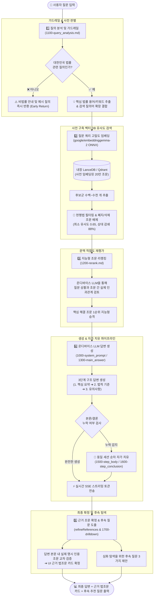

# ⚖️ 대한민국 법령 대화형 AI 챗봇 (Korean Law RAG)

대한민국 현행 법령 마크다운 데이터를 **조문(Article)** 단위로 정밀 파싱하고, **100% 로컬 온디바이스 임베딩**, **내장 벡터 데이터베이스(LanceDB / Qdrant)**, 그리고 **하드웨어 가속 온디바이스 LLM**을 결합한 오픈소스 법률 특화 RAG(Retrieval-Augmented Generation) 시스템입니다.

**Docker나 외부 유료 API 없이도** 내 로컬 PC에서 즉시 20만 개 조문을 초고속 검색하고 자연어로 상담할 수 있으며, **Tauri v2** 기반의 독립 실행형 크로스플랫폼 데스크톱 앱(macOS / Windows)과 모던 반응형 웹 UI를 모두 지원합니다.

특히 1B급 초경량 모델부터 시스템 사양(VRAM)이 충분하다면 **32B급 이상의 고사양 대형 모델까지 자유롭게 교체하여 구동**할 수 있어, **작은 모델의 가볍고 민첩한 응답 속도와 대형 모델의 정교하고 깊이 있는 법리 해석 및 복합 추론 능력 간의 뚜렷한 체감 차이**를 직접 비교하고 경험해 보실 수 있습니다.

### 📥 최신 데스크톱 앱 다운로드 (Latest Release)

별도의 개발 환경 구축 없이 단독 설치 파일로 즉시 실행할 수 있습니다:

| 플랫폼                      | 패키지 파일                       | 다운로드 링크                                                                                                             |
| :-------------------------- | :-------------------------------- | :------------------------------------------------------------------------------------------------------------------------ |
| 🍏 **macOS** (Apple Silicon) | `Korean-Law-RAG-latest.dmg`       | [**macOS DMG 다운로드**](https://github.com/monodle/rag/releases/download/latest/Korean-Law-RAG-latest.dmg)               |
| 🪟 **Windows** (x64)         | `Korean-Law-RAG-latest-setup.exe` | [**Windows Setup.exe 다운로드**](https://github.com/monodle/rag/releases/download/latest/Korean-Law-RAG-latest-setup.exe) |

> 🔗 모든 릴리즈 자산 및 SHA256 체크섬은 [**GitHub Releases (tag: latest)**](https://github.com/monodle/rag/releases/tag/latest)에서 확인하실 수 있습니다.

---

## 📑 목차
- [⚖️ 대한민국 법령 대화형 AI 챗봇 (Korean Law RAG)](#️-대한민국-법령-대화형-ai-챗봇-korean-law-rag)
    - [📥 최신 데스크톱 앱 다운로드 (Latest Release)](#-최신-데스크톱-앱-다운로드-latest-release)
  - [📑 목차](#-목차)
  - [✨ 핵심 특징](#-핵심-특징)
  - [🏛️ 시스템 아키텍처](#️-시스템-아키텍처)
  - [🔄 질의응답 처리 파이프라인 (Query-to-Answer Pipeline)](#-질의응답-처리-파이프라인-query-to-answer-pipeline)
    - [📌 단계별 상세 처리 로직](#-단계별-상세-처리-로직)
      - [1️⃣ 질의 의도 분석 및 사전 가드레일 (`1100-query_analysis.md`)](#1️⃣-질의-의도-분석-및-사전-가드레일-1100-query_analysismd)
      - [2️⃣ 질문 쿼리 임베딩 및 사전 구축 벡터 DB 유사도 검색 (`EmbeddingService` \& `LanceDbService`)](#2️⃣-질문-쿼리-임베딩-및-사전-구축-벡터-db-유사도-검색-embeddingservice--lancedbservice)
      - [3️⃣ 질문 문맥 적합도 지능형 리랭킹 (`1200-rerank.md`)](#3️⃣-질문-문맥-적합도-지능형-리랭킹-1200-rerankmd)
      - [4️⃣ 온디바이스 LLM 답변 생성 및 순차 자가 치유 (`LlamaCppService`)](#4️⃣-온디바이스-llm-답변-생성-및-순차-자가-치유-llamacppservice)
      - [5️⃣ 근거 조문 2단계 재평가 및 심화 질문 제안 (`1700-drilldown.md`)](#5️⃣-근거-조문-2단계-재평가-및-심화-질문-제안-1700-drilldownmd)
  - [🛠️ 기술 스택 \& 선정 모델](#️-기술-스택--선정-모델)
    - [🧠 지원 온디바이스 언어 모델 프리셋](#-지원-온디바이스-언어-모델-프리셋)
  - [📁 프로젝트 디렉터리 구조](#-프로젝트-디렉터리-구조)
  - [📋 사전 요구사항 (Prerequisites)](#-사전-요구사항-prerequisites)
  - [🚀 빠른 시작 가이드 (Quick Start)](#-빠른-시작-가이드-quick-start)
    - [⚡ 옵션 1. 올인원 원클릭 자동 셋업 (권장)](#-옵션-1-올인원-원클릭-자동-셋업-권장)
    - [🛠️ 옵션 2. 수동 단계별 셋업 (Step-by-Step)](#️-옵션-2-수동-단계별-셋업-step-by-step)
      - [1. 저장소 클론 및 패키지 설치](#1-저장소-클론-및-패키지-설치)
      - [2. 사전 구축된 20만 조문 벡터 DB 다운로드 (LanceDB)](#2-사전-구축된-20만-조문-벡터-db-다운로드-lancedb)
      - [3. 온디바이스 언어 모델(GGUF) 다운로드](#3-온디바이스-언어-모델gguf-다운로드)
      - [4. 애플리케이션 실행](#4-애플리케이션-실행)
  - [📦 데스크톱 앱 빌드 \& 배포 파이프라인](#-데스크톱-앱-빌드--배포-파이프라인)
    - [1. 플랫폼별 릴리즈 인스톨러 빌드](#1-플랫폼별-릴리즈-인스톨러-빌드)
    - [2. 백엔드 엔진 아카이브 패키징](#2-백엔드-엔진-아카이브-패키징)
    - [3. GitHub Releases 자동 배포](#3-github-releases-자동-배포)
  - [💻 CLI 유틸리티 및 명령어 요약](#-cli-유틸리티-및-명령어-요약)
  - [❓ 자주 묻는 질문 및 트러블슈팅 (FAQ)](#-자주-묻는-질문-및-트러블슈팅-faq)
    - [Q1. Docker가 꼭 설치되어 있어야 하나요?](#q1-docker가-꼭-설치되어-있어야-하나요)
    - [Q2. 20만 개 조문을 전부 인덱싱하려면 컴퓨터를 계속 켜두어야 하나요?](#q2-20만-개-조문을-전부-인덱싱하려면-컴퓨터를-계속-켜두어야-하나요)
    - [Q3. 온디바이스 LLM 답변 생성 속도를 더 빠르게 높이고 싶습니다.](#q3-온디바이스-llm-답변-생성-속도를-더-빠르게-높이고-싶습니다)
    - [Q4. 시스템 프롬프트나 어조를 바꾸고 싶습니다.](#q4-시스템-프롬프트나-어조를-바꾸고-싶습니다)
  - [⚖️ 법적 면책 조항 (Disclaimer)](#️-법적-면책-조항-disclaimer)
  - [📄 라이선스 (License)](#-라이선스-license)

---

## ✨ 핵심 특징

- 🏛️ **조문(Article) 단위 정밀 청킹 & 계층 컨텍스트**: 법령 마크다운에서 `제N조(제목)` 단위로 분할하고, 조문이 속한 상위 `편 > 장 > 절` 계층 정보를 메타데이터로 자동 주입하여 검색 정확도를 극대화합니다.
- ⚡ **Docker 없는 내장형 LanceDB 기본 탑재**: 별도의 Docker 컨테이너 설치 없이 Node.js 프로세스에 내장된 Apache Arrow 기반 고성능 벡터 DB(LanceDB)로 즉시 동작합니다. (Qdrant 선택 지원)
- 🚀 **사전 구축 20만 조문 원클릭 동기화**: 10~12시간이 걸리는 수동 인덱싱 없이, GitHub Releases에서 사전 구축된 최신 법령 벡터 DB를 단 한 번의 명령(`pnpm db:download`)으로 다운로드하여 즉시 사용할 수 있습니다.
- 🔒 **100% 로컬 온디바이스 임베딩**: 외부 유료 API나 Python 환경 없이 `google/embeddinggemma-2` ONNX 모델을 로컬(Transformers.js / ONNX Runtime)에서 직접 구동하여 768차원 고밀도 벡터를 생성합니다.
- 🧠 **하드웨어 가속 온디바이스 LLM**: `node-llama-cpp`를 통해 Apple Silicon(Metal) 및 PC(NVIDIA CUDA / CPU) 가속을 활용하여 LG EXAONE 4.0, HyperCLOVAX, Konan LLM 등 로컬 GGUF 모델을 초고속 추론합니다.
- 🛡️ **정밀 다단계 프롬프트 & 환각 방지 파이프라인**:
  - 질의 의도 분석 및 키워드 추출 (`1100-query_analysis.md`)
  - 조문 리랭킹 및 유사도 필터링 (`1200-rerank.md`)
  - 메인 답변 생성 및 본론/결론 누락 자가 복구 (`1300-main_answer.md`, `1500-step_body.md`, `1600-step_conclusion.md`)
  - 맞춤형 심화 후속 질문 자동 제안 (`1700-drilldown.md`)
- 💻 **Tauri v2 + React 19 크로스플랫폼**: Glassmorphism 다크 테마 UI를 지원하며 웹 브라우저(`localhost:5173`) 또는 경량 네이티브 데스크톱 앱(macOS DMG / Windows NSIS)으로 완벽하게 동작합니다.

---

## 🏛️ 시스템 아키텍처

```
[사용자 자연어 법률 질문]
        │
        ▼
[1. 쿼리 분석 및 키워드 추출 (1100-query_analysis.md)]
        │
        ▼
[2. 로컬 임베딩 생성 (EmbeddingService)]
    - 모델: google/embeddinggemma-2 (ONNX 768d, 100% 온디바이스 로컬 추론)
        │
        ▼
[3. 벡터 데이터베이스 하이브리드 검색]
    - 기본: 내장 LanceDB (Docker 불필요, 20만 조문 고속 검색)
    - 옵션: Qdrant Docker 컨테이너 (대규모 분산 환경)
    - 코사인 유사도 하한선(0.65) 및 상대 감쇄(88%) 1차 필터링
        │
        ▼
[4. 조문 리랭킹 및 검증 (1200-rerank.md)]
    - 질문과의 실질적 법적 연관성에 따라 핵심 근거 조문 재정렬
        │
        ▼
[5. 온디바이스 LLM 메인 답변 생성 (RagServer + node-llama-cpp)]
    - EXAONE 4.0 1.2B / EXAONE 3.5 7.8B / HyperCLOVAX / Konan LLM
    - Metal(Mac) / CUDA(PC) 하드웨어 GPU 가속
    - 조문 인용 필수, 비법률 질문 안내, SSE 스트리밍 실시간 전송
        │
        ├──▶ 본론/결론 누락 발생 시 자동 자가 복구 (1500-step_body / 1600-step_conclusion)
        └──▶ 심화 탐색을 위한 후속 질문 3가지 자동 제안 (1700-drilldown.md)
        │
        ▼
[6. 프론트엔드 UI (Tauri v2 / React 19 / Vite)]
    - 실시간 타이핑 렌더링, 인용 법조문 접이식 카드, 국가법령정보센터 원문 링크
```

---

## 🔄 질의응답 처리 파이프라인 (Query-to-Answer Pipeline)

사용자가 자연어로 법률 질문을 입력했을 때, 시스템이 법령 데이터베이스를 탐색하고 법적 근거가 검증된 신뢰성 높은 최종 답변과 인용 조문을 도출하기까지의 **5단계 오케스트레이션 파이프라인**입니다.



### 📌 단계별 상세 처리 로직

#### 1️⃣ 질의 의도 분석 및 사전 가드레일 (`1100-query_analysis.md`)
- 사용자의 입력이 일상 대화, 코딩, 단순 상식 등 **대한민국 법령과 무관한 질의**인 경우, 불필요한 벡터 DB 검색이나 환각 답변을 원천 차단하고 즉시 친절한 가이드 메시지를 반환(Early Return)합니다.
- 법률 질문인 경우 질문 의도에 내포된 **핵심 법률 용어(예: 주휴수당, 부당해고, 음주운전 처벌 기준 등)** 를 추출하고, 원본 질의와 유기적으로 결합하여 검색 적합도가 극대화된 임베딩 쿼리를 구성합니다.

#### 2️⃣ 질문 쿼리 임베딩 및 사전 구축 벡터 DB 유사도 검색 (`EmbeddingService` & `LanceDbService`)
- 사용자의 질문(및 확장 키워드)을 구글의 768차원 고성능 임베딩 모델(`google/embeddinggemma-2` ONNX)을 통해 100% 로컬에서 **768차원 쿼리 벡터**로 실시간 변환합니다.
- 동일한 임베딩 모델로 사전 벡터화된 **내장 LanceDB**(또는 Qdrant)의 20만 개 법률 조문 데이터베이스를 대상으로 코사인 거리 기반 고속 유사도 검색을 수행합니다.
- 구 폐지 법령, 실효 조문, `[본조삭제]` 조문을 메타데이터 수준에서 자동 필터링하며, 최소 코사인 유사도 하한선(`0.65`) 및 최상위 대비 상대 감쇄 비율(`88%`)을 충족하는 조문들만 1차 후보군으로 압축합니다.

#### 3️⃣ 질문 문맥 적합도 지능형 리랭킹 (`1200-rerank.md`)
- 단순 텍스트 유사도 매칭의 한계를 극복하기 위해, 온디바이스 LLM이 1차 선별된 조문들과 사용자의 구체적 사실관계를 정밀 비교합니다.
- 사안 해결에 직접적인 효력을 발휘하는 실질적 핵심 법조문(예: 상위 원칙 조항보다 구체적 특별 규정)을 **1순위로 지능형 승격**시켜 답변 생성 컨텍스트로 공급합니다.

#### 4️⃣ 온디바이스 LLM 답변 생성 및 순차 자가 치유 (`LlamaCppService`)
- Apple Silicon Metal 또는 NVIDIA CUDA GPU 가속을 통해 로컬 GGUF 모델(EXAONE, HyperCLOVAX, Konan)을 구동합니다.
- 답변은 정형화된 **3단 체계(1. 핵심 결론 요약 ➔ 2. 법적 기준 및 세부 적용 요건 ➔ 3. 실무상 유의사항 및 대응 방안)** 로 구조화되어 실시간 SSE 스트리밍으로 전송됩니다.
- **자가 치유 순차 파이프라인 (Self-Healing)**: 소형 경량 모델이 1단계 요약만 출력하고 답변을 조기 종료할 경우, 세션을 끊지 않고 `1500-step_body.md`(본론 작성) 및 `1600-step_conclusion.md`(결론 작성) 프롬프트를 연쇄 실행하여 누락된 본론과 결론을 스스로 완결합니다.

#### 5️⃣ 근거 조문 2단계 재평가 및 심화 질문 제안 (`1700-drilldown.md`)
- **근거 법조문 2단계 검증**: 검색된 조문 중 답변 본문에서 실제로 명시적 인용·해석된 법조문만을 엄격히 교차 대조하여 UI 우측/하단의 근거 법조문 카드로 확정합니다.
- **후속 질문 자동 도출**: 사용자가 법적 문제를 다각도로 검토하고 다음 행동을 취할 수 있도록 실무적으로 유용한 심화 후속 질문 3가지를 자동으로 추천합니다.

---

## 🛠️ 기술 스택 & 선정 모델

| 구분               | 기술 / 라이브러리                                    | 설명                                                                |
| :----------------- | :--------------------------------------------------- | :------------------------------------------------------------------ |
| **데스크톱 / UI**  | **Tauri v2**, **React 19**, **Vite**, **TypeScript** | 경량 네이티브 데스크톱 앱 및 모던 반응형 웹 프론트엔드              |
| **스타일링**       | **Vanilla CSS**                                      | 모던 다크 테마, HSL 기반 Glassmorphism 디자인 시스템                |
| **RAG 백엔드**     | **Node.js 22+**, **HTTP Streaming (SSE)**            | 초경량 네이티브 HTTP 서버 및 실시간 토큰 스트리밍                   |
| **임베딩 모델**    | **`google/embeddinggemma-2`** (ONNX 768d)            | `@huggingface/transformers` 로컬 추론 8,192 토큰 지원               |
| **벡터 DB**        | **LanceDB (기본, 로컬 내장형)**                      | **Docker 불필요**, Apache Arrow 기반 초고속 컬럼형 임베디드 벡터 DB |
| **벡터 DB (옵션)** | **Qdrant**                                           | Docker 기반 분산 벡터 데이터베이스 지원 (`VECTOR_STORE=qdrant`)     |
| **온디바이스 LLM** | **`node-llama-cpp`** (GGUF 추론 엔진)                | Apple Silicon Metal / NVIDIA CUDA 하드웨어 가속 지원                |
| **데이터셋**       | **legalize-kr** 마크다운 법령집                      | 대한민국 법제처 공공데이터 기반 현행 법률 아카이브                  |

### 🧠 지원 온디바이스 언어 모델 프리셋

`pnpm model:download` 실행 시 공식 HuggingFace 저장소에서 바로 다운로드할 수 있습니다:

1. **LG EXAONE 4.0 1.2B (기본 권장 ⭐)**: LG AI 연구원 공식 초경량 모델, CPU 및 보급형 GPU에서 가장 빠르고 정확한 한국어 법률 질의 최적화.
2. **LG EXAONE 3.5 7.8B Instruct**: 심층 법률 조항 해석을 위한 한국어 지시 튜닝 모델 (VRAM 8GB+ / Mac 통합 메모리 16GB+ 권장).
3. **NAVER HyperCLOVAX SEED 1.5B**: 네이버 클라우드 공식 한국어 특화 경량 지시 튜닝 모델 (1GB 미만 저사양 최적).
4. **Konan LLM OND (Q4_K_M / Q8_0)**: 코난테크놀로지 온디바이스 특화 경량 한국어 모델.

> 💡 **32B급 이상 커스텀 대형 모델 지원**: 시스템 사양(VRAM 또는 Apple 통합 메모리 32GB/64GB+)이 넉넉하다면 프리셋 외에도 보유 중인 임의의 GGUF 모델을 `data/models/` 경로에 배치한 후, **앱 상단의 [모델 설정] 화면에서 클릭 한 번으로 즉시 선택·교체**하여 초고성능 법률 추론 엔진으로 활용할 수 있습니다. (Hugging Face 저장소 검색 및 신규 모델 다운로드도 앱 UI에서 바로 지원)

---

## 📁 프로젝트 디렉터리 구조

```text
rag/
├── data/
│   ├── lancedb/              # LanceDB 내장 벡터 데이터베이스 (기본)
│   ├── models/               # 온디바이스 LLM GGUF 가중치 모델 저장소
│   ├── raws/                 # 대한민국 법령 마크다운 원본 (legalize-kr)
│   └── .indexed_laws.json    # 인덱싱 진행 상태 캐시 파일
├── prompts/                  # 다단계 RAG 파이프라인 프롬프트 (Hot-reload 지원)
│   ├── 1000-system_prompt.md # 메인 시스템 기본 규칙
│   ├── 1100-query_analysis.md# 질의 의도 분석 및 검색 키워드 추출
│   ├── 1200-rerank.md        # 검색된 조문 리랭킹
│   ├── 1300-main_answer.md   # 조문 기반 최종 답변 생성
│   ├── 1500-step_body.md     # 본론 누락 자가 복구
│   ├── 1600-step_conclusion.md # 결론 누락 자가 복구
│   └── 1700-drilldown.md     # 후속 추천 질문 자동 생성
├── src/
│   ├── config/               # 시스템 설정 및 상수 (constants.ts, sharedConstants.js)
│   ├── indexer/              # 임베딩 생성 및 벡터 DB 추상화 레이어
│   │   ├── embeddingService.ts # Transformers.js 로컬 임베딩
│   │   ├── lanceDbService.ts   # 내장 LanceDB 검색 및 관리
│   │   ├── qdrantService.ts    # Qdrant 컬렉션 검색 및 관리
│   │   └── dbSyncService.ts    # 20만 조문 벡터 DB 자동 다운로드/동기화
│   ├── parser/               # 법령 마크다운 파서 및 최신 법령 스캐너
│   ├── server/               # RAG 백엔드 HTTP 서버 및 추론 엔진
│   │   ├── ragServer.ts      # REST / SSE 스트리밍 API 엔드포인트
│   │   ├── llamaCppService.ts# node-llama-cpp 로컬 LLM 세션 관리
│   │   └── promptManager.ts  # 프롬프트 캐싱 및 실시간 핫리로드
│   ├── ui/                   # React 19 프론트엔드 인터페이스 (Vite)
│   └── scripts/              # 빌드, 셋업, 인덱싱, 릴리즈 CLI 도구 모음
├── src-tauri/                # Tauri v2 Rust 네이티브 데스크톱 앱 프로젝트
├── scripts/                  # 원클릭 OS별 셋업 및 래퍼 스크립트
├── .env.example              # 환경 변수 템플릿
├── package.json
└── README.md
```

---

## 📋 사전 요구사항 (Prerequisites)

1. **Node.js**: `v20.x` 이상 (LTS인 `v22.x` 강력 권장)
2. **패키지 매니저**: `pnpm` (`v9.x` 또는 `v10.x`)
   ```bash
   npm install -g pnpm
   ```
3. **Rust & Cargo** *(선택 사항)*:
   - **Tauri 데스크톱 앱**을 직접 로컬에서 빌드/개발할 경우에만 필요합니다. ([Rust 설치 안내](https://www.rust-lang.org/tools/install))
   - 브라우저 웹 UI로만 이용하실 분은 Rust 없이 Node.js만으로 모든 기능을 구동할 수 있습니다.
4. **Docker** *(선택 사항)*:
   - 기본 벡터 DB인 **LanceDB 사용 시 Docker가 전혀 필요하지 않습니다.**
   - 분산 Qdrant를 백엔드로 사용할 경우에만 Docker가 필요합니다.

---

## 🚀 빠른 시작 가이드 (Quick Start)

### ⚡ 옵션 1. 올인원 원클릭 자동 셋업 (권장)

처음 시작할 때는 대화형 자동 셋업 스크립트를 통해 전체 환경을 1분 만에 구축할 수 있습니다:

```bash
# OS별 원클릭 스크립트 실행
./scripts/setup.sh        # macOS / Linux
scripts\setup.bat         # Windows (명령 프롬프트 또는 더블클릭)

# 또는 pnpm 명령어로 직접 실행
pnpm setup
```

**자동으로 수행되는 작업:**
1. 🔍 **런타임 점검**: Node.js(v20+) 및 pnpm 버전 검사, `.env` 자동 복사
2. 📦 **의존성 설치**: `pnpm install` 누락 여부 확인 및 자동 설치
3. ⚡ **내장 벡터 DB**: GitHub Releases에서 검증된 20만 조문 LanceDB 데이터베이스 자동 다운로드 (Docker 불필요)
4. 📚 **법령 데이터셋**: `data/raws/`에 legalize-kr 원본 마크다운 데이터셋 클론
5. 🧠 **온디바이스 LLM**: 추천 한국어 모델(LG EXAONE 4.0 1.2B) 자동 다운로드 & `.env` 등록
6. ⚡ **로컬 임베딩**: 구글 `embeddinggemma-2` ONNX 모델 사전 로딩 & 워밍업

셋업 완료 후 바로 [실행](#4-애플리케이션-실행) 단계로 이동하시면 됩니다!

---

### 🛠️ 옵션 2. 수동 단계별 셋업 (Step-by-Step)

#### 1. 저장소 클론 및 패키지 설치
```bash
git clone https://github.com/monodle/rag.git
cd rag
pnpm install
cp .env.example .env
```

#### 2. 사전 구축된 20만 조문 벡터 DB 다운로드 (LanceDB)
직접 10시간 이상 인덱싱할 필요 없이 릴리즈에서 사전 구축된 최신 벡터 데이터를 내려받습니다:
```bash
pnpm db:download
```

#### 3. 온디바이스 언어 모델(GGUF) 다운로드
```bash
pnpm model:download
```
- 대화형 CLI 메뉴에서 추천 모델(`LG EXAONE 4.0 1.2B`)을 선택하면 `data/models/`에 저장되고 `.env`가 자동 갱신됩니다.
- *(참고: 모델 다운로드 없이 조문 검색 및 인용만 테스트하려면 `.env`에서 `USE_ONDEVICE_LLM=false`로 설정)*

#### 4. 애플리케이션 실행

**🖥️ 옵션 A: Tauri 데스크톱 애플리케이션 (권장 - 백엔드 통합 실행)**
```bash
pnpm tauri dev
```
- 백엔드 RAG 서버와 데스크톱 창이 동시에 실행됩니다.

**🌐 옵션 B: 웹 브라우저 개발 모드 (Rust 미설치 시)**
```bash
pnpm dev
```
- 백엔드 서버(포트 `34200`)와 Vite 프론트엔드가 실행되며, 웹 브라우저(`http://localhost:5173`)로 접속합니다.

---

## 📦 데스크톱 앱 빌드 & 배포 파이프라인

본 프로젝트는 C++ 네이티브 애드온(`node-llama-cpp`, `onnxruntime-node`, `@lancedb/lancedb`)을 사용자 환경에 구애받지 않고 배포하기 위해 **독립형 Standalone Engine 번들링 파이프라인**을 갖추고 있습니다.

### 1. 플랫폼별 릴리즈 인스톨러 빌드
```bash
# macOS (DMG 및 .app 애플리케이션 번들 빌드)
pnpm build:mac

# Windows (NSIS x64 단독 설치 프로그램 빌드)
pnpm build:win
# 또는 Windows 가상머신/PC에서:
scripts\build-win.bat

# 현재 운영체제 자동 감지 빌드
pnpm build:release
```

### 2. 백엔드 엔진 런타임 패키징
Tauri 스마트 웹 인스톨러가 최초 실행 시 다운로드하여 구동할 온디바이스 백엔드 엔진 런타임(Node 바이너리 + 네이티브 모듈)을 독립 아카이브로 패키징합니다:
```bash
# 로컬 백엔드 엔진 아카이브 패키징 (release/ 폴더에 생성)
pnpm engine:pack
```

### 3. GitHub Releases 자동 배포 (3대 독립 채널)
빌드 및 패키징된 에셋들을 목적과 다운로드 주체에 맞는 독립 릴리즈 채널로 배포합니다:

| 구분 | 릴리즈 채널 링크 | 주요 배포 에셋 | 배포 명령어 |
| :--- | :--- | :--- | :--- |
| **📦 설치 파일** | [**`latest`**](https://github.com/monodle/rag/releases/tag/latest) | `Korean-Law-RAG-latest.dmg`<br>`Korean-Law-RAG-latest-setup.exe` | `pnpm release:app` |
| **⚙️ 엔진 런타임** | [**`v1.0.0`**](https://github.com/monodle/rag/releases/tag/v1.0.0) | `korean_law_engine_mac_arm64.tar.gz`<br>`korean_law_engine_win_x64.tar.gz` | `pnpm engine:release` |
| **🗄️ 벡터 DB** | [**`data-v1`**](https://github.com/monodle/rag/releases/tag/data-v1) | `lancedb_korean_laws_200k.tar.gz` | `pnpm db:release` |

---

## 💻 CLI 유틸리티 및 명령어 요약

| 카테고리             | 스크립트 명령어        | 설명                                                                     |
| :------------------- | :--------------------- | :----------------------------------------------------------------------- |
| **초기 셋업**        | `pnpm setup`           | 환경 점검, 의존성, 20만 조문 DB, 모델 다운로드 올인원 대화형 셋업        |
| **실행**             | `pnpm tauri dev`       | Tauri 데스크톱 앱 실행 (백엔드 서버 자동 통합 실행)                      |
|                      | `pnpm dev`             | 브라우저 개발 모드 (백엔드 `34200` + Vite UI `5173` 동시 구동)           |
|                      | `pnpm dev:server`      | RAG HTTP 백엔드 서버 단독 실행 (SSE 스트리밍, Hot-reload)                |
|                      | `pnpm dev:ui`          | Vite 웹 프론트엔드 단독 구동 (`http://localhost:5173`)                   |
| **빌드 & 번들링**    | `pnpm build:ui`        | Vite 웹 프론트엔드 프로덕션 번들 빌드 (`dist-web/`)                       |
|                      | `pnpm build:server`    | esbuild 백엔드 독립 실행형 서버 번들링 (`dist-server/`)                   |
|                      | `pnpm sync:version`    | `package.json`, `tauri.conf.json`, `Cargo.toml` 버전 동기화               |
|                      | `pnpm build:mac`       | macOS DMG 및 앱 번들 릴리즈 빌드                                         |
|                      | `pnpm build:win`       | Windows NSIS x64 설치 파일 릴리즈 빌드                                   |
|                      | `pnpm build:release`   | 현재 OS에 맞는 데스크톱 인스톨러 빌드                                    |
|                      | `pnpm engine:pack`     | 독립 실행형 백엔드 엔진 런타임 아카이브 패키징                           |
| **데이터 & 벡터 DB** | `pnpm db:download`     | GitHub Releases에서 사전 구축된 20만 조문 LanceDB 다운로드               |
|                      | `pnpm db:migrate`      | Docker Qdrant의 기구축 벡터 데이터를 내장 LanceDB로 무재인덱싱 고속 복제 |
|                      | `pnpm db:pack`         | 로컬 LanceDB 데이터를 배포용 `korean_laws_lancedb.tar.gz`로 패키징       |
|                      | `pnpm db:release`      | GitHub Releases(`data-v1`)에 LanceDB 아카이브 에셋 배포                  |
|                      | `pnpm index:laws`      | 법령 마크다운 파싱 및 로컬 벡터 DB 인덱싱 (옵션: `--target`, `--limit`)  |
|                      | `pnpm parse:test`      | 법령 마크다운 조문 파서 정상 파싱 단위 검증                              |
| **모델 관리**        | `pnpm model:download`  | Hugging Face 최신 한국어 GGUF 온디바이스 모델 대화형 다운로더            |
|                      | `pnpm model:select`    | `data/models/` 내에 다운로드된 GGUF 모델 교체 및 `.env` 반영             |
| **CLI 검색/채팅**    | `pnpm search "<질문>"` | UI 없이 터미널에서 즉시 유사 법조문 코사인 검색 테스트                   |
|                      | `pnpm chat`            | 터미널 대화형 RAG 챗봇 세션 실행                                         |
| **GitHub 배포**      | `pnpm release:app`     | GitHub Releases(`latest`)에 데스크톱 인스톨러 배포                       |
|                      | `pnpm engine:release`  | GitHub Releases(`v1.0.0`)에 백엔드 엔진 런타임 에셋 배포                 |
|                      | `pnpm db:release`      | GitHub Releases(`data-v1`)에 LanceDB 벡터 데이터베이스 에셋 배포         |

---

## ❓ 자주 묻는 질문 및 트러블슈팅 (FAQ)

### Q1. Docker가 꼭 설치되어 있어야 하나요?
**아닙니다.** 기본 설정인 **LanceDB**는 로컬 프로세스 내장형 벡터 DB이므로 Docker가 전혀 필요하지 않습니다. Docker는 Qdrant를 명시적으로 사용할 때(`VECTOR_STORE=qdrant`)만 필요합니다.

### Q2. 20만 개 조문을 전부 인덱싱하려면 컴퓨터를 계속 켜두어야 하나요?
직접 전체 인덱싱을 수행하면 10~12시간이 걸릴 수 있습니다. 대신 제공되는 **`pnpm db:download`** 명령어를 사용하시면 이미 인덱싱이 완료된 20만 조문 데이터베이스를 수분 내에 내려받아 즉시 사용하실 수 있습니다.

### Q3. 온디바이스 LLM 답변 생성 속도를 더 빠르게 높이고 싶습니다.
- 추천 모델인 `LG EXAONE 4.0 1.2B` 또는 `HyperCLOVAX SEED 1.5B`와 같은 경량 모델을 선택하세요.
- Mac(Apple Silicon M1/M2/M3/M4)의 경우 Metal GPU 가속이 자동 활성화되어 초당 40~60+ 토큰의 초고속 답변 생성이 가능합니다.
- GPU 메모리가 부족하거나 검색 기능만 빠르게 활용하려면 `.env`의 `USE_ONDEVICE_LLM=false`로 설정하여 조문 검색 전용 모드로 이용할 수 있습니다.

### Q4. 시스템 프롬프트나 어조를 바꾸고 싶습니다.
`prompts/` 디렉터리의 마크다운 파일들을 자유롭게 수정하세요:
- `prompts/1000-system_prompt.md`: 시스템 페르소나 및 기본 원칙
- `prompts/1300-main_answer.md`: 답변 작성 형식 및 인용 가이드라인
파일을 수정하고 저장하면 백엔드 서버가 **재시작 없이 실시간 핫리로드(Hot-reload)** 로 즉시 새 프롬프트를 반영합니다.

---

## ⚖️ 법적 면책 조항 (Disclaimer)

1. 본 소프트웨어가 제공하는 검색 결과 및 인공지능 생성 답변은 대한민국 법제처 국가법령정보센터의 공개 공공데이터에 기초한 **단순 참고용 정보**입니다.
2. 시스템이 출력하는 내용은 **공인 변호사, 공인노무사, 법무사 등 법률 전문가의 유권해석이나 정식 법률 자문을 절대 대신할 수 없습니다.**
3. 법령의 개정 시점, 구체적인 사실관계 및 판례에 따라 실제 법 적용 결과는 상이할 수 있으므로, 실제 법적 분쟁이나 법률적 판단이 필요한 사안은 반드시 **공인된 법률 전문가와 직접 상담**하시기 바랍니다.
4. 개발자 및 기여자는 본 소프트웨어의 활용으로 인해 발생하는 직·간접적인 손해나 법적 결과에 대해 일체의 책임을 지지 않습니다.

---

## 📄 라이선스 (License)

This project is licensed under the [ISC License](LICENSE).
법령 원문 데이터의 저작권 및 공공누리 라이선스는 대한민국 법제처 및 [legalize-kr](https://github.com/legalize-kr/legalize-kr) 프로젝트의 가이드라인을 따릅니다.
